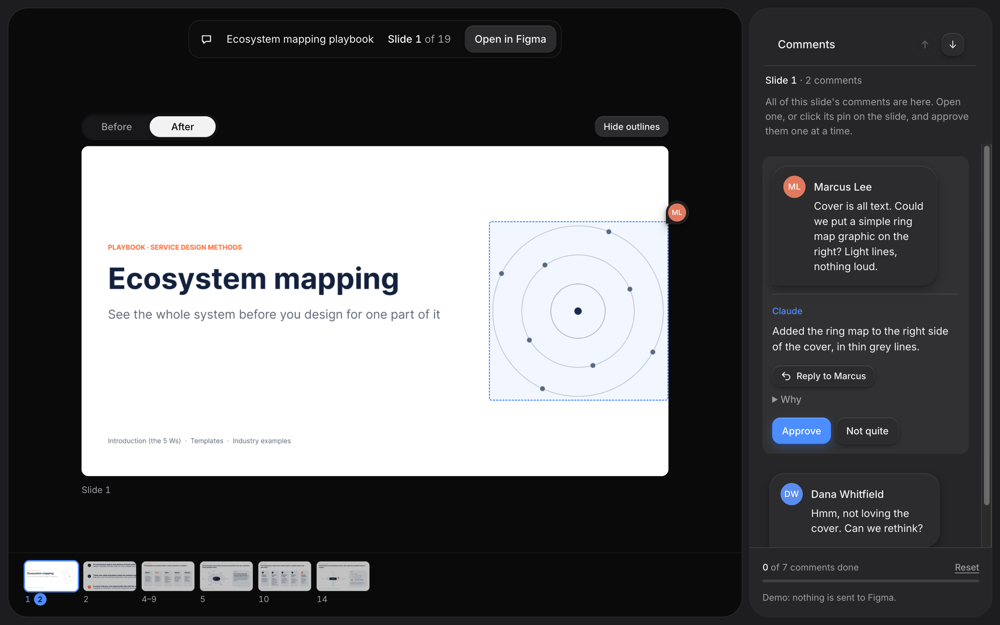

# Blueline

Reviewer comments on a Figma Slides deck in, approved changes out.

**[Try the demo](https://slsho.github.io/skill-blueline/)**. It runs in your browser: no Claude, no
Figma account, nothing to install.

[](https://slsho.github.io/skill-blueline/)

The demo replays one real review round: 7 comments from 4 reviewers on a 19-slide playbook.
The slides are captures from the Figma deck, before and after Blueline made each change. Click
through, approve, send a card back, undo; in the demo nothing is sent anywhere. In the real
tool, Approve edits the deck in Figma straight away and posts the reply in the reviewer's thread.

## Why

When a deck goes out for review, the comments come back in every shape: a typo, "soften
this", "doesn't land for me", two people asking for opposite things. Working through them
by hand takes longer than writing the deck did. Blueline is a Claude Code skill that does
the working-through, and leaves you only the deciding.

## How it works

1. **You run `/blueline:blueline <figma-slides-link>`** when the review round closes (or just ask Claude
   to work through the comments on that deck). Claude reads every open comment and the deck itself.
2. **Claude drafts an answer for each comment.** A clear ask becomes a change. A vague comment or
   a source question becomes a reply. Two reviewers who disagree get a choice of options.
   A change that touches nine slides is decided once.
3. **You review on one page.** The slide fills the screen with the change outlined; click it to see
   the slide as it is now. Scroll for the next slide. Tap the new wording or a reply to change it
   yourself.
4. **You approve card by card.** Each *Approve* goes into the deck in Figma straight away, in your
   wording, and its reply goes into the reviewer's thread. You keep reviewing while Claude works,
   and every card shows where it's at. *Not quite* sends a card back to Claude with your note, and
   *Undo* takes back anything you've done: an approved change comes out of the deck, and a posted
   reply comes out of the reviewer's thread.

## Run it yourself (optional)

You don't need any of this to try the demo. To run Blueline on your own deck, you need
[Claude Code](https://claude.com/claude-code), Figma connected to it, and a Figma token for
reading and posting comments.

1. **Install the plugin** (in a terminal):
   ```
   claude plugin marketplace add slsho/skill-blueline
   claude plugin install blueline@blueline
   ```
   Or copy the whole `skills/blueline` folder into `~/.claude/skills/`; it's then `/blueline`.
2. **Connect Figma** to Claude Code (Figma's MCP server). Claude edits slides through it, signed in
   as you.
3. **Add your Figma token** for comments: in Figma, Settings > Security > Personal access tokens,
   with `file_comments:write` and `file_content:read`. Then, in the folder you run Claude Code from:
   ```
   cp .env.example .env    # paste your token into .env; it never leaves your computer
   ```
4. Run `/blueline:blueline https://www.figma.com/slides/...` on a deck with comments. For a first run, use a
   duplicate of the deck (Figma: file name > Duplicate) and put a few comments on it.

## What's in here

```
skills/blueline/
  SKILL.md                    the workflow Claude follows
  app/index.html              the review page (reads data.json)
  scripts/serve.py            serves the page and records each decision as you make it
  scripts/next.py             tells Claude the moment you approve, send back or undo a card
  scripts/progress.py         shows Claude's progress on each card in the page
  scripts/fetch_comments.py   reads comment threads from Figma
  scripts/post_replies.py     posts approved replies into their threads
  scripts/diffboxes.py        finds what changed between two slide images
  references/                 data format and tested Figma edit recipes
docs/                         the demo (static, no server)
assets/                       the screenshot at the top of this README
tests/                        automated tests
```

## Tests

```
python3 -m unittest discover -s tests -v
```

They cover the Figma scripts (with Figma's API faked), the review server, the outline finder,
and the demo data. The page itself and the Figma edits were tested by running a full round on
a duplicate deck.

## Privacy

Everything runs on your computer. The review server only listens on `localhost`. Your Figma
token stays in your `.env`, which git ignores, and Claude's Figma access is your own login.
Review rounds (comments, decisions, slide images) are written to `./blueline-review/`, also
git-ignored.
